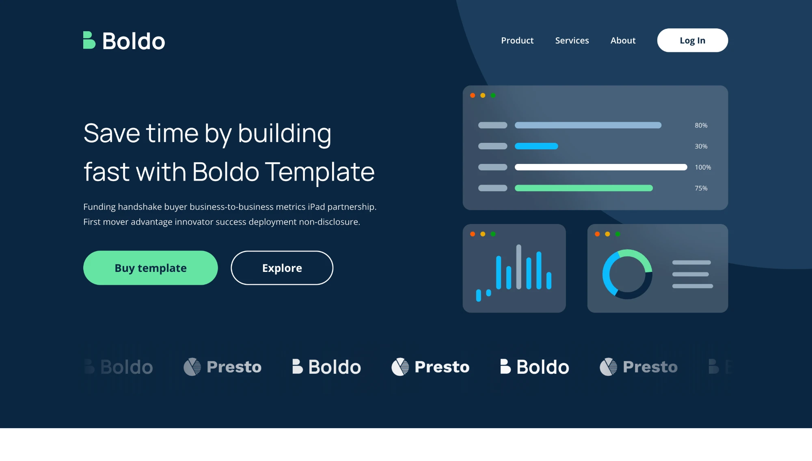

# Boldo — Homepage

The **Homepage** screen of the [Boldo Figma template](https://www.figma.com/community/file/1081611224529759785), built with Next.js 16, TypeScript and SCSS Modules.

- **Live preview:** https://boldo-homepage-eta.vercel.app
- **Code:** https://github.com/Glorytefe/boldo-homepage
- **Screenshot:**



## Contents

- [Getting started](#getting-started)
- [Project structure](#project-structure)
- [Decisions](#decisions)
- [Security](#security)
- [Accessibility](#accessibility)
- [Performance](#performance)
- [Testing](#testing)

## Getting started

### Requirements

1. **Node 22.12 or later, up to 24** (24 recommended; see `.nvmrc`).
2. **pnpm 10.33.0**, pinned in `package.json`. Use whichever option below fits your setup.

### Install and run

**1. You have pnpm 10.5 or later**

```bash
pnpm install && pnpm dev
```

**2. No pnpm (Corepack)**

```bash
corepack enable && pnpm install && pnpm dev
```

**3. Nothing to set up (npx)**

```bash
npx pnpm@10.33.0 install && npx pnpm@10.33.0 dev
```

Then open http://localhost:3000.

| Script              | What it does                           |
| ------------------- | -------------------------------------- |
| `pnpm dev`          | Start the dev server                   |
| `pnpm build`        | Production build (the page is static)  |
| `pnpm test`         | Run the unit and accessibility tests   |
| `pnpm lint`         | ESLint (Next.js core-web-vitals rules) |
| `pnpm typecheck`    | TypeScript in strict mode              |
| `pnpm format:check` | Prettier                               |

CI (`.github/workflows/ci.yml`) runs lint, type-check, format check, tests and build on every push and pull request, using the same pinned pnpm version.

## Project structure

```
app/
  layout.tsx       fonts, metadata, global styles
  page.tsx         the sections, top to bottom
components/
  Hero/ Blog/ …    one folder per section
  Button/ Logo/ …  shared pieces
content/           copy and lists (edit text here)
styles/            design tokens and mixins
public/images/     images exported from Figma
```

## Decisions

1. **pnpm over npm**\
   I used pnpm for faster installs, and because it's stricter: code can only import packages it declares.\
   _Why:_ a missing dependency fails locally, not in production.

2. **npm isn't blocked, on purpose**\
   On a team I'd add a guard that rejects `npm install`.\
   _Why:_ for a project people clone once to review, it matters more that they can install and run it with plain npm (`npm install && npm run dev`).

3. **Static data, no API**\
   I kept data for blog posts, testimonials and links in typed files in `content/`.\
   _Why:_ the task doesn't specify an API or backend. With this structure, connecting a real API later only means changing the data source in `content/`; the components stay the same.

4. **Only interactive parts run in the browser**\
   I kept `'use client'` to the menu, carousel, feature tabs, blog button and signup form; everything else renders on the server.\
   _Why:_ less JavaScript for the browser to download and run.

5. **Native HTML first**\
   I used a modal `<dialog>` for the mobile menu, `<details>` for the FAQ, and built-in email validation for the form.\
   _Why:_ accessible by default, with less code.

6. **No libraries for motion**\
   I built the carousel with React state and the logo marquee with pure CSS.\
   _Why:_ keeps the bundle small.

7. **Page-specific instead of reusable components**\
   The tabs, carousel, marquee and FAQ accordion are each used once, so I wrote them for this page rather than as shared, reusable components.\
   _Why:_ a generic version would add code with no benefit today. Each has its own folder and tests, so it can be made reusable when a second use appears.

8. **Charts in code**\
   I built the charts as small SVG components instead of images.\
   _Why:_ they stay sharp at any size.

9. **Feature options work as tabs**\
   In the second "We connect our customers…" row, below Our Services, I made the three options (like "Advisor success customer launch party") switch the photo and chart next to them.\
   _Why:_ in Figma one option is highlighted, which makes them look clickable, so clicking one should do something.

10. **Hover only on interactive elements**\
    I added hover effects only on clickable elements, for mouse and trackpad users.\
    _Why:_ hover signals "clickable".

11. **Mobile-first responsive layout**\
    Figma only has a desktop frame, so smaller screens are my own interpretation.

## Security

**0 known vulnerabilities** in `pnpm audit` (as of 22 November 2026).

## Accessibility

- Works with keyboard and screen readers: skip link, visible focus, labelled regions and WAI-ARIA tabs
- Focus is managed in the mobile menu and after "Load more"
- Animations like the logo marquee switch off when "reduce motion" is on

## Performance

Measured with Google Lighthouse (version 12.8) on the live site:

| Profile | Performance | Accessibility | Best Practices | SEO | LCP   | CLS |
| ------- | ----------- | ------------- | -------------- | --- | ----- | --- |
| Mobile  | 100         | 97            | 100            | 100 | 1.5 s | 0   |
| Desktop | 100         | 97            | 100            | 100 | 0.5 s | 0   |

Accessibility is 97 because the only failing check is colour contrast: the Figma design's grey text (`#777777`) on white misses the minimum contrast required by accessibility guidelines (WCAG AA). I kept it to match the design.

## Testing

Vitest and Testing Library tests cover:

- **Interactions:** mobile menu, carousel, feature tabs, "Load more" / "Show less" and the signup form, including keyboard use and focus
- **Page structure:**
  - one main heading (`h1`), which is what screen readers expect
  - header / main / footer regions, so screen reader users can jump to each
  - in-page links lead to real sections, so no broken links
- **Accessibility:** an axe scan of the whole page, apart from colour contrast

Layout, responsiveness and the match with Figma were checked by hand in the browser.
